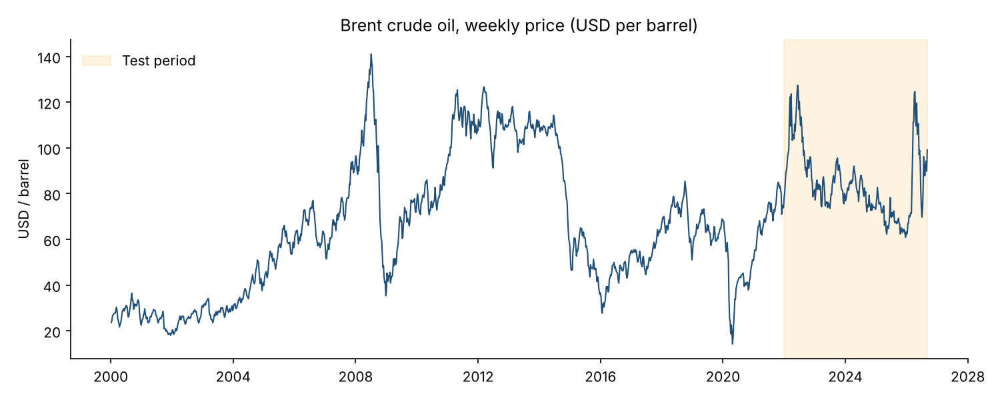
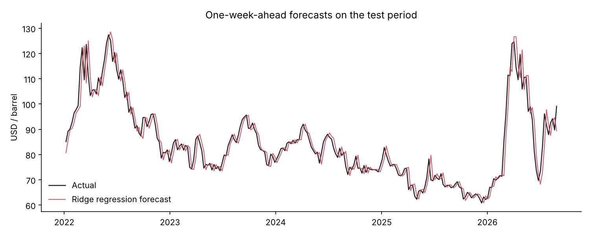
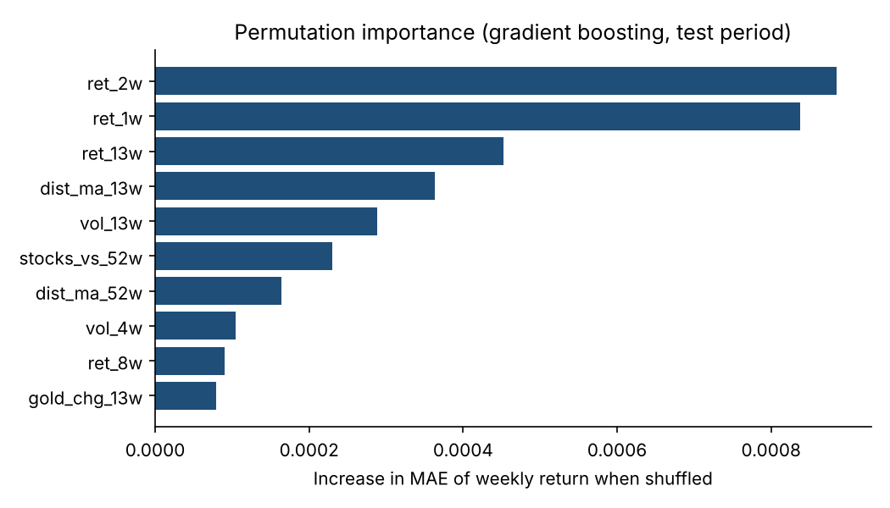

# Brent Crude Oil Price Forecasting

Forecasting next week's Brent crude oil price with machine learning, using 26 years of weekly prices (2000–2026) together with oil-market fundamentals and macroeconomic indicators.



## Question

Can price momentum, U.S. supply data and macro indicators predict next week's Brent price better than simply assuming *no change*?

## Data

Ten public time series, stored in [`data/raw/`](data/raw):

| Series | Frequency | Source |
|---|---|---|
| Brent crude spot price (USD/bbl) | Weekly | FRED / EIA |
| WTI crude spot price (USD/bbl) | Weekly | FRED / EIA |
| U.S. crude oil ending stocks excl. SPR | Weekly | EIA |
| U.S. crude oil field production | Weekly | EIA |
| Nominal Broad U.S. Dollar Index | Daily | FRED (DTWEXBGS) |
| Consumer Price Index | Monthly | FRED (CPIAUCSL) |
| Federal Funds Effective Rate | Monthly | FRED (FEDFUNDS) |
| Henry Hub natural gas spot price | Monthly | FRED / EIA (MHHNGSP) |
| U.S. Industrial Production | Monthly | FRED |
| Gold price (USD/oz) | Monthly | Public monthly series |

## Method

1. **Alignment** ([`src/data_prep.py`](src/data_prep.py)). All series are put on a week-ending-Friday calendar. Daily data is averaged weekly. Monthly data is **shifted by one month before forward-filling**, so the model only uses macro figures that would already have been published on the forecast date. This avoids look-ahead bias.
2. **Target.** The model predicts next week's log return of Brent. That return is converted back to a price: `forecast = price_now × exp(predicted return)`.
3. **Features (20).**
   - Momentum: returns over 1, 2, 4, 8, 13 and 26 weeks.
   - Volatility: 4-week and 13-week.
   - Distance from moving averages: 13-week and 52-week.
   - Brent–WTI spread.
   - Fundamentals: change in U.S. crude stocks, stocks vs. their 52-week average, change in U.S. production.
   - Macro: change in the dollar index, gold and natural gas; CPI and industrial production year over year; 26-week change in the Fed funds rate.
4. **Models.** Ridge regression, random forest, gradient boosting (scikit-learn), plus a naive **no-change baseline**.
5. **Walk-forward evaluation** ([`src/train.py`](src/train.py)). Training starts in 2007 and testing covers January 2022 to August 2026 (243 weeks). Models are refit on an expanding window every 13 weeks, so every forecast uses only data available at that time.

## Results

One-week-ahead forecasts on the 2022–2026 test period:

| Model | MAE ($/bbl) | RMSE ($/bbl) | MAPE (%) | Direction accuracy (%) |
|---|---:|---:|---:|---:|
| **Naive (no change)** | **3.16** | **4.48** | **3.59** | – |
| Ridge regression | 3.19 | 4.51 | 3.62 | 48.6 |
| Random forest | 3.21 | 4.59 | 3.65 | 48.6 |
| Gradient boosting | 3.30 | 4.72 | 3.74 | 51.4 |



**Key finding: no model beat the no-change baseline.** The best model (ridge) was within about 1% of the naive forecast's error. The models also called the direction of next week's move about as often as a coin flip. This is consistent with the weak-form efficient-market view of liquid commodity prices: public information is already priced in by the time weekly data is released. The test period (Russia–Ukraine shock in 2022, the 2026 spike) was also unusually volatile.



The most informative features were recent momentum (1-, 2- and 13-week returns) and the distance from the 13-week moving average. Among the fundamentals, U.S. crude stocks relative to their yearly average ranked highest. The macro variables contributed little at a one-week horizon.

## Possible next steps

- Longer horizons (1–3 months), where fundamentals and macro data should matter more.
- Predicting volatility or large moves instead of the price level.
- Futures curve data (contango/backwardation), OPEC+ announcements and news sentiment.
- Classical time-series benchmarks (ARIMA, GARCH) and gradient boosting with tuned hyperparameters.

## Reproduce

```bash
pip install -r requirements.txt
cd src
python data_prep.py   # builds data/processed/brent_weekly_features.csv
python train.py       # walk-forward evaluation -> results/ and figures/
```

## Repository structure

```
data/raw/        original CSV files
src/data_prep.py data cleaning, alignment and feature engineering
src/train.py     walk-forward training, evaluation and charts
results/         metrics.csv and weekly test predictions
figures/         charts used in this README
```

---
MS Data Science project · Youngstown State University
